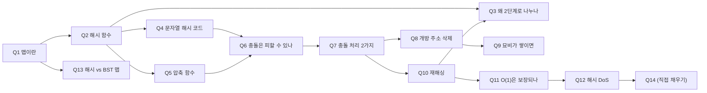

### source
**원본 스크립트** : [[interview/10.1_10.2 맵과 해시 테이블|10.1_10.2 맵과 해시 테이블 (독백형 원본)]]
**concept** : [[concepts/data_structure/10.1_10.2 맵과 해시 테이블|concept 노트]]
**skeleton** : [[10.1_10.3_맵과_딕셔너리_및_해시_테이블과_정렬된_맵]]
**조합 노드** : [[_combo/해시 테이블의 O(1)은 진짜 O(1)인가|🧩 해시 테이블의 O(1)은 진짜 O(1)인가]]

> [!info] 카드 ID 규칙 (시범 적용)
> - 각 카드 뒷면 바로 아래 `^maphash-qNN`이 카드의 **고정 ID**. 질문 문구를 고쳐도 링크가 끊기지 않음
> - 이 파일 안에서 이동: `[[#^maphash-q10|Q10]]` / 다른 파일에서 링크: `[[10.1_10.2 맵과 해시 테이블 (카드형)#^maphash-q10]]`
> - 다른 파일에 끼워 넣기: `![[10.1_10.2 맵과 해시 테이블 (카드형)#^maphash-q10]]`
> - 챕터를 넘나드는 큰 질문은 `_combo/`에서 카드를 끼워 넣어 조립

---

## 0. 흐름 한 줄 (안 보고 써지면 통과)

```
맵(ADT) → 해시 테이블로 구현 → 해시 함수 = 해시 코드 + 압축 함수
→ 충돌은 필연 → 처리: 체이닝 / 개방 주소(→ 지연 삭제)
→ λ↑ 성능↓ → 재해싱(2배, 분할상환 O(1))
→ 그래도 O(1)은 "평균" → 최악 O(n) 노린 DoS → 해시 코드 랜덤화
```



> [!tip] 사용법
> - **앞면** = `### Q` 제목만 보고 소리 내어 답하기 → **뒷면**(접힌 callout)을 펼쳐 **키워드가 들어갔는지만** 체크
> - 문장 암기 ❌ / **두괄식 1문장 + 키워드 3개** 기억 ⭕
> - 막히면 `왜 이렇게 답하나` 줄과 링크를 따라가 concept에서 맥락 복원
> - `꼬리 →`의 링크를 눌러 다음 카드로 이동하며 체인 연습

---

## 1. 맵 & 해시 함수

### Q1. 맵(Map)이 무엇인지 설명해 주세요.
> [!answer]- 뒷면
> - **두괄식**: 맵은 고유한 키를 값에 연결하는 **추상 자료형**입니다.
> - **키워드**: `고유 키` / `값은 중복 가능` / `ADT → 해시 테이블 or 균형 BST로 구현`
> - **풀어 말하기**: 배열과 달리 키가 정수이거나 연속적일 필요가 없고, 키는 중복될 수 없지만 서로 다른 키가 같은 값을 가지는 건 가능합니다. 보통 해시 테이블이나 균형 이진 탐색 트리로 구현합니다.
> - **왜 이렇게 답하나**: 마지막에 "구현 방법 2가지"를 던져두면 면접관이 *해시 테이블(Q2)* 또는 *BST와 비교(Q13)* 로 꼬리질문을 할 수밖에 없음 → 내가 준비한 쪽으로 대화를 유도하는 장치
>   → [[concepts/data_structure/10.1_10.2 맵과 해시 테이블#맵(ADT)]]
> - **함정**: "맵 = 해시 테이블"이라고 말하지 않기. 맵은 **ADT(인터페이스)**, 해시 테이블은 **자료구조(구현)**
> - **꼬리 →** [[#^maphash-q02|Q2]], [[#^maphash-q13|Q13]]

^maphash-q01

### Q2. 해시 테이블에서 해시 함수는 어떻게 동작하나요?
> [!answer]- 뒷면
> - **두괄식**: 키를 버킷 배열 인덱스(0 ~ N−1)로 바꾸는 함수이고, **해시 코드 + 압축 함수** 두 단계로 나뉩니다.
> - **키워드**: `해시 코드 = 크기 무관 정수` / `압축 함수 = 0~N−1로 축소` / `2단계`
> - **풀어 말하기**: 먼저 키를 테이블 크기와 무관한 정수로 바꾸는 해시 코드가 있고, 그 정수를 버킷 배열 크기 범위로 줄이는 압축 함수가 있습니다.
> - **왜 이렇게 답하나**: "2단계"라는 구조를 먼저 말해두면, "왜 나눴냐(Q3)"는 질문이 자연스럽게 따라옴. 원본 스크립트에선 이 이유까지 한 문단에 다 말했는데, **카드로 쪼개서 면접관이 묻게 두는 편**이 답변이 짧고 명확해짐
>   → [[10.1_10.3_맵과_딕셔너리_및_해시_테이블과_정렬된_맵#2. 해시 테이블(Hash Table)의 2단계 매핑 아키텍처]]
> - **꼬리 →** [[#^maphash-q03|Q3]], [[#^maphash-q04|Q4]], [[#^maphash-q05|Q5]]

^maphash-q02

### Q3. 해시 코드와 압축 함수를 왜 따로 나누나요?
> [!answer]- 뒷면
> - **두괄식**: 테이블 크기가 바뀌어 **재해싱할 때 해시 코드는 재사용**하고 압축 함수만 다시 적용하기 위해서입니다.
> - **키워드**: `해시 코드는 N과 무관` / `재해싱 시 재사용` / `압축 함수만 재적용`
> - **왜 이렇게 답하나**: 이 질문의 답은 **재해싱(Q10)** 과 연결됨. "재해싱할 때 해시 코드도 다시 계산하나요?"라는 질문도 같은 답 → 한 카드로 두 질문을 커버
>   → [[concepts/data_structure/10.1_10.2 맵과 해시 테이블#압축함수]] (하단 "따로 구현하는 이유?")
> - **함정**: "계산이 편해서" 같은 막연한 이유 ❌ → 반드시 **재해싱**이라는 구체적 상황으로 답하기
> - **꼬리 →** [[#^maphash-q10|Q10]]

^maphash-q03

### Q4. 문자열 키의 해시 코드는 어떻게 만드나요?
> [!answer]- 뒷면
> - **두괄식**: 문자열은 **순서가 중요**하므로, 위치마다 다른 가중치를 곱하는 **다항식 해시**나 비트를 회전시키는 **순환 시프트 해시**를 씁니다.
> - **키워드**: `단순 합 → 순서 소실(stop = pots)` / `다항식 해시 aⁿ⁻¹…` / `순환 시프트`
> - **풀어 말하기**: 문자 코드를 단순히 더하면 stop과 pots가 같은 값이 됩니다. 그래서 자리마다 a의 거듭제곱을 곱해 순서를 반영합니다. 정수는 그대로, 64비트 실수는 상·하위 32비트를 XOR로 합쳐 씁니다.
> - **왜 이렇게 답하나**: 원본 스크립트는 "정수 → 실수 → 문자열"을 나열했는데, 면접에선 **"왜 단순 합이 안 되나"(stop/pots)라는 반례 하나**가 나열보다 강력함. 반례로 시작 → 해결책 순서
>   → [[concepts/data_structure/10.1_10.2 맵과 해시 테이블#해시 코드]]
>   → [[10.1_10.3_맵과_딕셔너리_및_해시_테이블과_정렬된_맵#2.1 1단계: 해시 코드(Hash Code) 설계와 엔지니어링 원리]]
> - **꼬리 →** [[#^maphash-q06|Q6]] ("그래도 충돌이 나나요?")

^maphash-q04

### Q5. 압축 함수에는 어떤 방법이 있나요?
> [!answer]- 뒷면
> - **두괄식**: **나눗셈 방법**(i mod N)과 **MAD 방법**([(ai + b) mod p] mod N)이 있습니다.
> - **키워드**: `mod N, N은 소수` / `MAD = 무작위 a, b로 패턴 파괴` / `균등 분포 1/N`
> - **풀어 말하기**: 나눗셈 방법은 N이 합성수면 해시 코드의 규칙적인 간격이 그대로 충돌로 이어져서 N을 소수로 잡습니다. MAD는 무작위 상수를 곱하고 더해서 해시 코드의 패턴 자체를 깨뜨립니다.
> - **왜 이렇게 답하나**: 원본에선 "덜 겹침..."으로 끝났던 부분. **"N이 100이면 5의 배수 해시 코드들이 몰린다"** 는 구체적 이유를 알아야 "왜 소수?"에 답할 수 있음
>   → [[10.1_10.3_맵과_딕셔너리_및_해시_테이블과_정렬된_맵#2.2 2단계: 압축 함수(Compression Function) 비교]]
> - **꼬리 →** [[#^maphash-q06|Q6]]

^maphash-q05

---

## 2. 충돌과 충돌 처리

### Q6. 해시 충돌은 왜 생기고, 피할 수 있나요?
> [!answer]- 뒷면
> - **두괄식**: **피할 수 없습니다.** 그래서 충돌을 없애는 게 아니라 **처리**하는 방법이 필요합니다.
> - **키워드**: `키 공간 무한 vs 버킷 유한` / `해시 코드 단계 + 압축 단계 둘 다에서 발생` / `없애기 ❌ 처리 ⭕`
> - **풀어 말하기**: 키로 쓸 수 있는 값은 사실상 무한한데 버킷 배열 크기는 한정돼 있어서, 서로 다른 키가 같은 인덱스로 가는 건 필연입니다. 해시 코드 단계(stop/pots)에서도, 압축 단계(같은 나머지)에서도 생깁니다.
> - **왜 이렇게 답하나**: "피할 수 없다 → 그래서 처리해야 한다"로 끝내면 면접관이 **Q7(처리 방식)** 로 넘어가게 됨. 원본 스크립트의 "그래서 해시 테이블에서는 충돌을 없애는 게 아니라…" 문장이 바로 이 연결 고리였음
>   → [[concepts/data_structure/10.1_10.2 맵과 해시 테이블#해시 함수]]
> - **함정**: "좋은 해시 함수를 쓰면 충돌이 없다" ❌ → 좋은 해시 함수는 충돌을 **고르게 분산**시킬 뿐
> - **꼬리 →** [[#^maphash-q07|Q7]]

^maphash-q06

### Q7. 해시 충돌을 처리하는 방법들을 비교해 주세요.
> [!answer]- 뒷면
> - **두괄식**: 버킷마다 리스트를 두는 **분리 체이닝**과, 배열 안 다른 칸을 조사하는 **개방 주소 방식**이 있습니다.
> - **키워드**: `체이닝: 평균 O(1+λ), λ>1 가능` / `개방 주소: 선형·이차·이중 해싱, λ<1` / `클러스터링`
> - **풀어 말하기**: 분리 체이닝은 같은 버킷에 온 항목을 체인에 함께 저장하고, 평균 O(1 + λ)라 재해싱으로 λ를 상수로 유지하면 O(1)입니다. 개방 주소는 칸에 직접 저장하고 차 있으면 정해진 순서(다음 칸, 제곱 간격, 두 번째 해시)로 다른 칸을 봅니다.
> - **왜 이렇게 답하나**: 비교 질문은 **"구조 차이 1줄 → 성능 차이 1줄"** 순서가 핵심. 세부 조사 방식 3개는 나열만 하고, 면접관이 파고들면 클러스터링(선형=일차, 이차=이차, 이중 해싱=해소)으로 확장
>   → [[10.1_10.3_맵과_딕셔너리_및_해시_테이블과_정렬된_맵#3.1 분리 체이닝 vs 개방 주소 방식 트레이드오프 비교]]
> - **꼬리 →** [[#^maphash-q08|Q8]] (개방 주소 삭제), [[#^maphash-q10|Q10]] (λ가 커지면?)

^maphash-q07

### Q8. 개방 주소 방식에서 삭제는 어떻게 하나요?
> [!answer]- 뒷면
> - **두괄식**: 칸을 비우지 않고 **묘비(`_AVAIL`) 표시를 남기는 지연 삭제**를 합니다.
> - **키워드**: `검색은 빈 칸에서 멈춤` / `비우면 탐사 경로 단절` / `묘비는 건너뛰고, 삽입 시 재사용`
> - **풀어 말하기**: 개방 주소 방식은 검색이 빈 칸을 만나면 멈추기 때문에, 중간 칸을 그냥 비우면 그 뒤에 저장된 키를 찾지 못합니다. 그래서 묘비를 두고, 검색은 묘비를 건너뛰고 진짜 빈 칸에서만 멈추며, 삽입은 처음 만난 묘비 자리를 재사용합니다.
> - **왜 이렇게 답하나**: 핵심은 **"검색이 빈 칸에서 멈춘다"** 는 전제. 이걸 먼저 말해야 지연 삭제가 "왜" 필요한지가 성립함. 예시가 필요하면 그림 10.7 (15가 4→8번 칸에 저장, 6번의 37 삭제)
>   → [[concepts/data_structure/10.1_10.2 맵과 해시 테이블#지연삭제]]
> - **함정**: "분리 체이닝도 지연 삭제가 필요하다" ❌ → 체인에서 바로 지워도 다른 키 경로에 영향 없음. **탐사 경로를 공유하는 개방 주소 특유의 문제**
> - **꼬리 →** [[#^maphash-q09|Q9]]

^maphash-q08

### Q9. 묘비가 계속 쌓이면 어떤 문제가 생기나요?
> [!answer]- 뒷면
> - **두괄식**: 적재율은 낮게 계산되는데 **실제 빈 칸(`None`)은 줄어서** 탐사가 길어지고, 극단적으로는 검색이 끝나지 않습니다.
> - **키워드**: `묘비는 n에 미포함` / `None 고갈 → 무한 루프` / `묘비 포함해 재해싱 시점 결정, 재해싱하면 묘비 소멸`
> - **왜 이렇게 답하나**: Q8을 잘 답하면 거의 반드시 오는 꼬리질문. "문제 → 해결(재해싱)"까지 말하면 **Q10으로 다시 연결**됨
>   → [[concepts/data_structure/10.1_10.2 맵과 해시 테이블#지연삭제 연관 : `find_slot` 상태 기계]] (하단 예상 꼬리질문)
> - **꼬리 →** [[#^maphash-q10|Q10]]

^maphash-q09

---

## 3. 성능 유지와 한계

### Q10. 재해싱은 언제, 어떻게 하나요? 왜 두 배로 늘리나요?
> [!answer]- 뒷면
> - **두괄식**: 적재율이 임곗값을 넘으면 **약 두 배 크기**의 배열을 만들고, 모든 항목을 **새 압축 함수로 다시 삽입**합니다.
> - **키워드**: `임곗값: 체이닝 0.9 / 선형 조사 0.5` / `2배 → 분할상환 O(1)` / `해시 코드는 재사용`
> - **풀어 말하기**: 항목이 많아지면 체인이 길어지거나 조사가 늘어나서 성능이 떨어집니다. 개방 주소는 λ가 1을 넘을 수 없어서 임곗값을 더 낮게 잡습니다. 두 배씩 늘리면 옮기는 총량이 1+2+4+…+n < 2n이라 삽입 한 번당 분할 상환 O(1)입니다.
> - **왜 이렇게 답하나**: "왜 2배?"에는 **상수 c씩 늘리면 O(n²/c) → 삽입당 O(n)** 이라는 반대 경우까지 말할 수 있어야 함. 동적 배열(5.3절) 확장과 같은 원리라고 연결하면 가산점
>   → [[concepts/data_structure/10.1_10.2 맵과 해시 테이블#동적 재해싱]]
>   → [[concepts/data_structure/5.1_5.3 배열의 정의와 종류#분할 지불(Amortization) : 왜 2배 확장 시 `append`가 $O(1)$인가?]] (같은 원리)
> - **꼬리 →** [[#^maphash-q03|Q3]] (해시 코드도 다시 계산?), [[#^maphash-q11|Q11]]

^maphash-q10

### Q11. 해시 테이블의 O(1)은 항상 보장되나요?
> [!answer]- 뒷면
> - **두괄식**: 아닙니다. **좋은 해시 함수 + λ = O(1) 유지**를 전제로 한 **평균**이고, 모든 키가 한 버킷에 몰리면 최악 O(n)입니다.
> - **키워드**: `평균 ≠ 최악` / `재해싱 = λ를 지키는 장치` / `랜덤화 = 평균 가정을 지키는 장치`
> - **왜 이렇게 답하나**: 이 카드가 **Q10(재해싱)과 Q12(DoS)를 잇는 다리**. 원본 스크립트의 "다만 해시 테이블의 O(1)은 어디까지나 평균이라서…" 문장이 바로 이 질문에 대한 답이었음
>   → [[concepts/data_structure/10.1_10.2 맵과 해시 테이블#동적 재해싱(Rehashing)과 해시 충돌 DoS 공격 방어]] (하단 예상 꼬리질문)
> - **함정**: 삽입의 "분할 상환 O(1)"(재해싱 비용 분산)과 탐색의 "평균 O(1)"(해시 분포 가정)을 섞지 않기 → [[#^maphash-q10|Q10]]
> - **꼬리 →** [[#^maphash-q12|Q12]]

^maphash-q11

### Q12. 해시 충돌 DoS 공격이 무엇이고, 어떻게 방어하나요?
> [!answer]- 뒷면
> - **두괄식**: 해시 코드가 같은 키를 대량으로 보내 **최악 O(n)을 유도**하는 공격이고, **해시 코드 계산 자체를 랜덤화**해서 막습니다.
> - **키워드**: `n개 저장에 O(n²)` / `같은 해시 코드는 압축·재해싱으로 분리 불가` / `랜덤 시드(2012) → SipHash(3.4)` / `Java 8: 체인 → RB 트리`
> - **풀어 말하기**: 해시 코드가 같으면 압축 결과도 항상 같아서 테이블을 키우거나 MAD의 a, b를 바꿔도 소용없습니다. 그래서 **압축 단계 이전**에서 해시 코드를 예측할 수 없게 만들어야 합니다. 보조책으로 체인이 길어지면 레드-블랙 트리로 바꿔 버킷 내 최악을 O(log n)으로 줄이는 방법도 있습니다.
> - **왜 이렇게 답하나**: 가장 중요한 논리는 **"왜 재해싱/MAD로는 못 막나"**. `hash(k1) == hash(k2)` → `[(a·h+b) mod p] mod N`도 항상 같음. 이걸 설명할 수 있으면 Q2~Q3(2단계 구조)을 진짜 이해했다는 증거가 됨
>   → [[concepts/data_structure/10.1_10.2 맵과 해시 테이블#해시 충돌 DoS 공격과 방어]]
> - **함정**: "재해싱하면 분산된다" ❌
> - **꼬리 →** [[#^maphash-q14|Q14]]

^maphash-q12

### Q13. 해시 테이블 기반 맵과 균형 BST 기반 맵은 어떻게 다른가요?
> [!answer]- 뒷면
> - **두괄식**: 해시 맵은 **평균 O(1)이지만 순서가 없고**, BST 맵은 **O(log n)이지만 키 순서를 유지하고 충돌 개념이 없습니다.**
> - **키워드**: `해시: 정수 변환 → 충돌 존재` / `BST: 전순서(비교) → 충돌 없음` / `범위 탐색·정렬 순회 필요하면 BST`
> - **풀어 말하기**: BST 기반 맵(Java `TreeMap`, C++ `std::map`)은 키를 정수로 바꾸지 않고 비교로 위치를 정합니다. 서로 다른 키는 비교 결과가 반드시 < 또는 >라서 같은 자리로 갈 수 없습니다. 대신 키가 비교 가능해야 합니다.
> - **왜 이렇게 답하나**: 원본 스크립트에서 충돌 처리 중간에 "참고로…"로 끼어 있던 내용 → 흐름을 끊으므로 **별도 카드로 분리**. Q1에서 "구현 2가지"를 던졌을 때 받는 꼬리질문
>   → [[concepts/data_structure/10.1_10.2 맵과 해시 테이블#맵(ADT)]]
>   → [[10.1_10.3_맵과_딕셔너리_및_해시_테이블과_정렬된_맵#4.2 맵 구현체 3종 종합 시간 복잡도 비교 (표 10.2 & 10.3 통합)]]
> - **꼬리 →** (10.3 정렬된 맵 / 11장 BST로 연결)

^maphash-q13

---

## 4. ✍️ 직접 채울 카드 (원본 "추가로 정리할 것"에서 이관)

### Q14. 개방 주소 방식이 분리 체이닝보다 해시 DoS나 높은 적재율에 더 취약한 이유는?
> [!answer]- 뒷면 (직접 작성)
> - **두괄식**: 
> - **키워드**: 
> - **왜 이렇게 답하나**: 
> - **힌트 (지울 것)**: 이 3가지를 연결해 보기 → ① 개방 주소는 항목들이 **탐사 경로를 공유**한다([[#^maphash-q08|Q8]]) ② 선형 조사의 **일차 클러스터링**([[#^maphash-q07|Q7]]) ③ λ < 1 상한과 묘비([[#^maphash-q09|Q9]])
>   → [[10.1_10.3_맵과_딕셔너리_및_해시_테이블과_정렬된_맵#3.1 분리 체이닝 vs 개방 주소 방식 트레이드오프 비교]]

^maphash-q14
