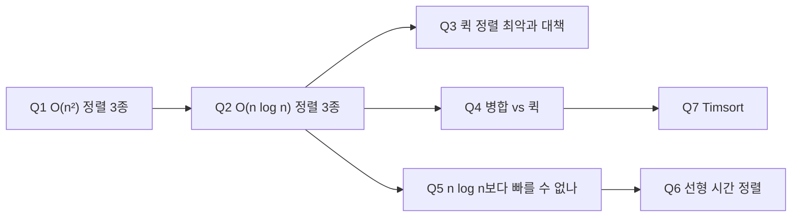

### source
**서술식 스크립트** : [[interview/12 정렬|서술식 초안]]
**concept** : [[concepts/data_structure/12 정렬|concept 노트]]
**skeleton** : [[12.1_12.7_정렬과_선택]]

> [!info] 카드 ID: `^sort-qNN`. 안정성은 [[12.1 안정 정렬 (카드형)]], 제자리 퀵 정렬은 [[12.2 제자리 정렬 (카드형)]]

---

## 0. 흐름 한 줄

```
O(n²): 버블(인접 swap, 안정) / 선택(최솟값 선택, 불안정, 항상 n²) / 삽입(끼워 넣기, 안정, 정렬되면 O(n))
→ O(n log n): 병합(항상 n log n, 안정, 추가 O(n)) / 퀵(평균 최고 속도, 최악 n²) / 힙(최악 n log n, 추가 O(1))
→ 비교 기반 하한 Ω(n log n) → 키가 정수면 버킷·기수 정렬로 선형
→ 실무: Timsort = 병합 + 삽입 (이미 정렬된 구간 활용)
```



---

### Q1. 버블, 선택, 삽입 정렬을 비교해 주세요.
> [!answer]- 뒷면
> - **두괄식**: 셋 다 O(n²)·제자리 정렬이지만, **버블과 삽입은 안정**, **선택은 불안정**하고, **삽입 정렬만 정렬된 입력에서 O(n)** 입니다.
> - **키워드**: `버블: 인접 swap, 안정` / `선택: 최솟값을 앞자리와 swap, 불안정, 항상 n²` / `삽입: 앞쪽 정렬 구간에 끼워 넣기, 안정, 최선 O(n)`
> - **풀어 말하기**: 버블 정렬은 인접한 두 원소를 비교해 바꾸는 걸 반복해서 큰 값이 끝으로 밀려나구요. 선택 정렬은 매번 남은 부분에서 최솟값을 골라 맨 앞과 바꾸는데, 입력과 상관없이 항상 전체를 보고, 멀리 떨어진 원소를 바꾸다 보니 같은 값의 순서가 뒤바뀔 수 있어서 불안정합니다. 삽입 정렬은 앞쪽 정렬된 부분에 자기 자리를 찾아 끼워 넣는데, 이미 정렬돼 있으면 한 번씩만 비교해서 O(n)입니다.
> - **왜 이렇게 답하나**: 셋의 차이를 **"안정성 + 최선의 경우"** 두 축으로만 비교. 선택 정렬이 불안정한 이유(**멀리 떨어진 swap**)를 말할 수 있어야 함
>   → [[concepts/data_structure/12 정렬#$O(n^2)$ 정렬]]
> - **꼬리 →** [[#^sort-q02|Q2]], [[12.1 안정 정렬 (카드형)#^stable-q01|12.1 안정 정렬]]

^sort-q01

### Q2. O(n log n) 정렬들(병합, 퀵, 힙)을 비교해 주세요.
> [!answer]- 뒷면
> - **두괄식**: **병합**은 항상 O(n log n)·안정이지만 **추가 메모리 O(n)**, **퀵**은 평균적으로 가장 빠르지만 **최악 O(n²)**, **힙**은 추가 메모리 없이 **최악도 O(n log n)** 입니다.
> - **키워드**: `병합: 반으로 분할 → 병합, 안정, O(n) 임시 배열` / `퀵: 피벗 파티셔닝, 평균 최고, 최악 n²` / `힙: 최악 n log n, O(1) 공간, 불안정·캐시 불리`
> - **풀어 말하기**: 병합 정렬은 반으로 잘라 각각 정렬한 뒤 합치는데, 항상 O(n log n)이고 안정적이지만 합칠 때 임시 배열이 필요합니다. 퀵 정렬은 피벗보다 작은 건 왼쪽, 큰 건 오른쪽으로 나눠 재귀적으로 정렬하는데, 평균적으로 가장 빠르지만 피벗을 잘못 고르면 O(n²)이구요. 힙 정렬은 추가 메모리가 거의 없으면서 최악에도 O(n log n)이지만, 불안정하고 캐시 효율이 떨어집니다.
> - **왜 이렇게 답하나**: 각 정렬의 **"장점 1개 + 대가 1개"** 로 짝지어 말하기. 이 대가들이 Q3, Q4의 꼬리질문이 됨
>   → [[concepts/data_structure/12 정렬#$O(n log_{n})$ 정렬]]
>   → [[12.1_12.7_정렬과_선택#5.1 주요 정렬 알고리즘 엔지니어링 트레이드오프 비교표]]
> - **꼬리 →** [[#^sort-q03|Q3]], [[#^sort-q04|Q4]], [[#^sort-q05|Q5]]

^sort-q02

### Q3. 퀵 정렬은 언제 O(n²)이 되고, 어떻게 막나요?
> [!answer]- 뒷면
> - **두괄식**: **이미 정렬된 입력에서 첫·마지막 원소를 피벗으로** 고르면 매번 한쪽으로만 나뉘어 O(n²)이 되고, **무작위 피벗이나 세 값의 중앙값(median-of-three)** 으로 막습니다.
> - **키워드**: `한쪽 n−1, 다른 쪽 0 → 높이 n` / `랜덤 피벗 → 기대 O(n log n)` / `median-of-three` / `1/4 : 3/4로만 나뉘어도 O(log n) 높이`
> - **풀어 말하기**: 퀵 정렬은 분할 트리의 높이만큼 O(n)씩 일하는데요, 정렬된 배열에서 끝 원소를 피벗으로 쓰면 매번 n−1개와 0개로 나뉘어서 높이가 n이 되고 O(n²)이 됩니다. 그래서 피벗을 무작위로 고르거나, 앞·중간·뒤 세 값의 중앙값을 피벗으로 써서 한쪽으로 쏠리지 않게 합니다. 정확히 반이 아니어도, 1 대 3 정도로만 나뉘면 높이는 여전히 log n입니다.
> - **왜 이렇게 답하나**: 원인을 **"트리 높이"** 로 설명하면 BST 편향(11.1)과 같은 구조라 연결하기 좋음. 랜덤화 증명은 "좋은 피벗 확률이 1/2"까지만
>   → [[concepts/data_structure/12 정렬#퀵 정렬]]
>   → 📌 [[12.1_12.7_정렬과_선택#3.1 퀵 정렬의 수행 시간과 최악 $\Theta(n^2)$ 병목 원인]] (concept 미정리)
> - **꼬리 →** [[12.2 제자리 정렬 (카드형)#^inplace-q02|12.2 제자리 퀵 정렬]]

^sort-q03

### Q4. 병합 정렬과 퀵 정렬은 각각 언제 쓰나요?
> [!answer]- 뒷면
> - **두괄식**: **안정성이 필요하거나 연결 리스트·디스크 같은 순차 접근 환경**이면 병합 정렬, **메모리 안의 일반 배열**이면 캐시 효율이 좋은 퀵 정렬이 유리합니다.
> - **키워드**: `병합: 안정, 최악 보장, 순차 접근 → 외부 정렬·연결 리스트` / `퀵: 제자리, 캐시 지역성 → 인메모리 최고 속도` / `실시간이면 퀵 최악 주의`
> - **풀어 말하기**: 병합 정렬은 최악도 O(n log n)이고 안정적이고, 데이터를 앞에서부터 순서대로 읽고 쓰니까 디스크에 있는 대용량 데이터나 연결 리스트 정렬에 잘 맞습니다. 퀵 정렬은 추가 배열 없이 제자리에서 나누고, 연속된 메모리를 차례로 훑어서 캐시를 잘 타기 때문에 메모리 안의 배열에서는 실제로 가장 빠릅니다.
> - **왜 이렇게 답하나**: concept에 없는 "**어디에 쓰나**"를 skeleton 비교표로 보강. 접근 패턴(순차 vs 제자리)으로 선택 기준을 말하는 게 핵심
>   → 📌 [[12.1_12.7_정렬과_선택#5.1 주요 정렬 알고리즘 엔지니어링 트레이드오프 비교표]] (concept 미정리)
> - **꼬리 →** [[#^sort-q07|Q7]]

^sort-q04

### Q5. 비교 기반 정렬은 O(n log n)보다 빨라질 수 없나요?
> [!answer]- 뒷면
> - **두괄식**: 네, **비교만으로 정렬하면 최악 Ω(n log n)이 하한**입니다. n개의 가능한 순서 n!개를 비교 결과로 모두 구분해야 하기 때문입니다.
> - **키워드**: `결정 트리: 비교 1번 = 2갈래` / `리프 ≥ n! → 높이 ≥ log(n!)` / `log(n!) = Ω(n log n)`
> - **풀어 말하기**: 비교 정렬은 "a가 b보다 작은가?"를 계속 묻는 거라서 이진 트리로 그릴 수 있는데요, 입력이 n!가지 순서로 들어올 수 있고 각각 다른 결과로 가야 하니까 리프가 n!개 이상이어야 합니다. 높이 h인 이진 트리의 리프는 최대 2^h개라서, h는 log(n!) 이상이고 이게 n log n 수준입니다.
> - **왜 이렇게 답하나**: 증명은 **"n!개를 구분 → 높이 log(n!)"** 직관만. 이 하한을 깨려면 "비교를 안 하면 된다" → Q6
>   → 📌 [[12.1_12.7_정렬과_선택]] §4.1 "결정 트리를 통한 Ω(n log n) 하한 증명" (concept 미정리)
> - **꼬리 →** [[#^sort-q06|Q6]]

^sort-q05

### Q6. 선형 시간 정렬(버킷, 기수 정렬)은 어떻게 가능한가요?
> [!answer]- 뒷면
> - **두괄식**: 키가 **작은 범위의 정수**처럼 정해져 있으면, 비교하지 않고 **키를 배열 인덱스로 바로 써서** 버킷에 나눠 담기 때문에 O(n + N)에 정렬됩니다.
> - **키워드**: `버킷 정렬: 키 = 인덱스, O(n + N)` / `기수 정렬: 낮은 자릿수부터 안정 정렬 반복, O(d(n + N))` / `조건: 키 범위가 작아야 함`
> - **풀어 말하기**: 버킷 정렬은 0부터 N−1 범위의 정수 키라면 키 값을 그대로 배열 칸 번호로 써서 넣고, 칸 순서대로 꺼내면 정렬이 끝납니다. 기수 정렬은 여러 자릿수 키를 가장 낮은 자릿수부터 버킷 정렬하는 걸 반복하는데, 매번 안정 정렬이어야 앞 단계의 순서가 유지됩니다. 대신 키 범위가 크면 버킷이 너무 많아져서 쓸 수 없습니다.
> - **왜 이렇게 답하나**: concept의 "계수/기수/버킷 정렬" 섹션이 비어 있음 → skeleton으로 보강. **"왜 낮은 자릿수부터?"** 는 안정성(12.1)과 연결되는 좋은 꼬리질문
>   → 📌 [[12.1_12.7_정렬과_선택#4.2 비교를 우회하는 선형 시간 정렬: 버킷 정렬(Bucket-Sort)과 기수 정렬(Radix-Sort)]] (concept 미정리)
> - **꼬리 →** [[12.1 안정 정렬 (카드형)#^stable-q04|12.1 기수 정렬과 안정성]]

^sort-q06

### Q7. 실제 언어의 기본 정렬은 무엇을 쓰나요?
> [!answer]- 뒷면
> - **두괄식**: Python, Java 객체 정렬 등은 **병합 정렬과 삽입 정렬을 합친 Timsort**를 씁니다. 실제 데이터에는 **이미 정렬된 구간이 많다**는 점을 활용합니다.
> - **키워드**: `Timsort = 병합 + 삽입` / `정렬된 구간(run) 감지` / `최선 O(n), 최악 O(n log n), 안정`
> - **풀어 말하기**: 실제 데이터는 어느 정도 정렬돼 있는 경우가 많아서, Timsort는 이미 정렬된 구간을 찾아 그대로 쓰고, 짧은 구간은 작은 배열에 강한 삽입 정렬로 늘린 다음 병합 정렬로 합칩니다. 그래서 거의 정렬된 데이터면 O(n)에 가깝고, 최악에도 O(n log n)에 안정적입니다.
> - **왜 이렇게 답하나**: 각 정렬의 **장점을 조합**한 사례 → 삽입 정렬(작은·거의 정렬된 입력) + 병합 정렬(최악 보장, 안정)
>   → [[concepts/data_structure/12 정렬#**팀소트 (Timsort)**]]
> - **꼬리 →** —

^sort-q07

---

## 📌 concept 보강 후보
- Q3: 퀵 정렬 최악의 원인을 "트리 높이"로 설명 → 📌 skeleton §3.1
- Q4: 병합 vs 퀵의 사용처 → 📌 skeleton §5.1
- Q5~Q6: concept의 "계수 정렬 / 기수 정렬 / 버킷 정렬" 헤딩이 비어 있음 → 📌 skeleton §4
