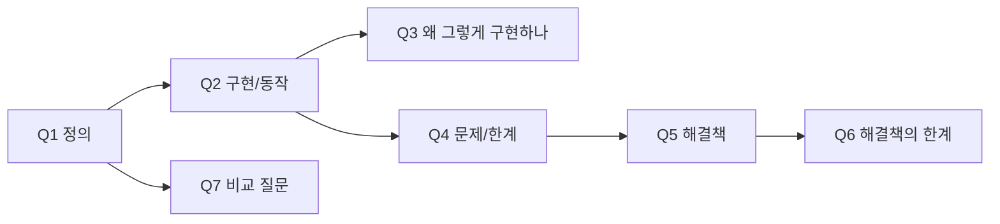

<!--
=====================================================================
 꼬리질문 카드형 인터뷰 스크립트 템플릿
 - 예시본: [[10.1_10.2 맵과 해시 테이블 (카드형)]]
 - 사용법: 이 파일을 knowledge_base/tail_interview/<subject>/<절번호 주제> (카드형).md 로 복사해서 작성
 - 근거 우선순위: ① 해당 절 concept → ② 다른 절 concept → ③ 📌 skeleton (concept에 없을 때만, 보강 후보로 기록)
 - 작성 순서:
   ① source 채우기 → ② 흐름 한 줄 (concept 보고 1번, 안 보고 1번)
   → ③ 흐름의 화살표(→) 하나하나를 "면접관 질문"으로 바꿔 Q 목록 만들기
   → ④ 카드 뒷면 채우기 (두괄식 · 키워드부터, 풀어 말하기는 마지막)
   → ⑤ 꼬리 → 연결 확인 후 mermaid 갱신
 - 원칙:
   · 카드 1장 = 질문 1개 = 30초 답변. 길어지면 쪼개서 꼬리질문으로 넘기기
   · "왜 이렇게 답하나"는 절대 비우지 않기 (시간이 지나 맥락을 복원하는 유일한 단서)
   · 모든 근거는 [[concept/skeleton#섹션]] 링크로 남기기
 이 주석 블록은 복사 후 지워도 됩니다.
=====================================================================
-->

### source
**서술식 스크립트** : [[interview/ ]]
**concept** : [[concepts/<subject>/ ]]
**skeleton** : [[ ]]

---

## 0. 흐름 한 줄 (안 보고 써지면 통과)

```
<개념(ADT/정의)> → <구현 방식> → <핵심 메커니즘> → <발생하는 문제/한계> → <해결책> → <해결책의 한계> → <다음 개념>
```



> [!tip] 사용법
> - **앞면** = `### Q` 제목만 보고 소리 내어 답하기 → **뒷면**(접힌 callout)을 펼쳐 **키워드가 들어갔는지만** 체크
> - 문장 암기 ❌ / **두괄식 1문장 + 키워드 3개** 기억 ⭕
> - 막히면 `왜 이렇게 답하나` 줄과 링크를 따라가 concept에서 맥락 복원

<!--
  질문 유형 가이드 (7단계 concept 흐름 → 면접관 질문 변환)
  | concept 단계 | 면접관 질문 형태 |
  |---|---|
  | 배경   | "왜 이 자료구조가 필요한가요?" / "기존 방식의 문제는?" |
  | 정의   | "~이 무엇인지 설명해 주세요." (오프닝) |
  | 구현   | "~는 어떻게 동작/구현하나요?" |
  | 이유   | "왜 그렇게 구현하나요?" / "왜 A가 아니라 B인가요?" |
  | 활용   | "실제로 어디에 쓰이나요?" |
  | 장단점 | "~와 비교해 주세요." / "항상 O(1)이 보장되나요?" |
  | 한계   | "그러면 ~한 경우엔 어떻게 되나요?" → 다음 자료구조로 브릿지 |
-->

---

## 1. <섹션명: 정의 & 동작>

### Q1. <오프닝 질문: ~이 무엇인지 설명해 주세요.>
> [!answer]- 뒷면
> - **두괄식**: 
> - **키워드**: `` / `` / ``
> - **풀어 말하기**: 
> - **왜 이렇게 답하나**: <이 답이 어떤 꼬리질문을 유도하는지 / 왜 이 순서·표현을 골랐는지>
>   → [[concept#섹션]]
> - **함정**: <말하면 안 되는 표현, 흔한 오해>
> - **꼬리 →** Q2

### Q2. <구현/동작 질문>
> [!answer]- 뒷면
> - **두괄식**: 
> - **키워드**: `` / `` / ``
> - **풀어 말하기**: 
> - **왜 이렇게 답하나**: 
>   → [[concept#섹션]]
> - **함정**: 
> - **꼬리 →** Q3

### Q3. <이유 질문: 왜 그렇게 구현하나요?>
> [!answer]- 뒷면
> - **두괄식**: 
> - **키워드**: `` / `` / ``
> - **풀어 말하기**: 
> - **왜 이렇게 답하나**: 
>   → [[concept#섹션]]
> - **함정**: 
> - **꼬리 →** 

---

## 2. <섹션명: 문제 & 해결>

### Q4. <문제/한계 질문>
> [!answer]- 뒷면
> - **두괄식**: 
> - **키워드**: `` / `` / ``
> - **풀어 말하기**: 
> - **왜 이렇게 답하나**: 
>   → [[concept#섹션]]
> - **함정**: 
> - **꼬리 →** Q5

### Q5. <해결책 질문>
> [!answer]- 뒷면
> - **두괄식**: 
> - **키워드**: `` / `` / ``
> - **풀어 말하기**: 
> - **왜 이렇게 답하나**: 
>   → [[concept#섹션]]
> - **함정**: 
> - **꼬리 →** Q6

---

## 3. <섹션명: 한계 & 비교>

### Q6. <해결책의 한계 / "항상 보장되나요?">
> [!answer]- 뒷면
> - **두괄식**: 
> - **키워드**: `` / `` / ``
> - **풀어 말하기**: 
> - **왜 이렇게 답하나**: 
>   → [[concept#섹션]]
> - **함정**: 
> - **꼬리 →** 

### Q7. <비교 질문: A와 B는 어떻게 다른가요?>
> [!answer]- 뒷면
> - **두괄식**: 
> - **키워드**: `` / `` / ``
> - **풀어 말하기**: 
> - **왜 이렇게 답하나**: 
>   → [[concept#섹션]]
> - **함정**: 
> - **꼬리 →** <다음 절/장으로 브릿지>

---

## 4. ✍️ 직접 채울 카드 (아직 답을 모르는 질문)

### Q?. <질문>
> [!answer]- 뒷면 (직접 작성)
> - **두괄식**: 
> - **키워드**: 
> - **왜 이렇게 답하나**: 
> - **힌트 (지울 것)**: <연결해 볼 카드 번호 / 근거 링크>

---

## 📌 concept 보강 후보 (skeleton으로 근거를 대체한 카드)
<!-- concept에 없어서 skeleton을 인용한 카드만 나열. 없으면 섹션 삭제 -->
- Q?: <빠진 내용 한 줄> → 📌 [[skeleton#섹션]]
